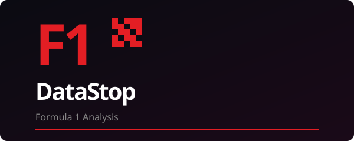

<!-- Open Graph / Social Preview -->
<meta property="og:title" content="F1 DataStop — Formula 1 Data Analysis Platform" />
<meta property="og:description" content="Timing, telemetry, charts & standings. Built with React, Supabase, Cloudflare R2, and Vercel." />
<meta property="og:image" content="https://raw.githubusercontent.com/ibrahimroshdy/f1datastop/main/og-image.png" />
<meta property="og:url" content="https://github.com/ibrahimroshdy/f1datastop" />
<meta property="og:type" content="website" />
<meta name="twitter:card" content="summary_large_image" />
<meta name="twitter:title" content="F1 DataStop — Formula 1 Data Analysis Platform" />
<meta name="twitter:description" content="Timing, telemetry, charts & standings." />
<meta name="twitter:image" content="https://raw.githubusercontent.com/ibrahimroshdy/f1datastop/main/og-image.png" />

# F1 DataStop

<p align="center">
  
</p>

<p align="center">
  <strong>Formula 1 data analysis platform — timing, telemetry, charts & standings.</strong>
</p>

<p align="center">
  <a href="https://f1datastop.vercel.app">Live Demo</a> •
  <a href="#features">Features</a> •
  <a href="#getting-started">Getting Started</a> •
  <a href="#project-structure">Architecture</a> •
  <a href="CONTRIBUTING.md">Contributing</a> •
  <a href="CHANGELOG.md">Changelog</a>
</p>

<p align="center">
  <a href="https://github.com/ibrahimroshdy/f1datastop/actions/workflows/pr-ci.yml"></a>
  <a href="https://github.com/ibrahimroshdy/f1datastop/releases/latest"></a>
  <a href="https://github.com/ibrahimroshdy/f1datastop/blob/main/LICENSE"></a>
</p>

---

## Pipeline status

All CI runs on **GitHub Actions** ([`.github/workflows/pr-ci.yml`](.github/workflows/pr-ci.yml)) —
fork-safe (zero secrets): web typecheck, advisory lint, test, build + Python byte-compile.
Scheduled jobs (reconcile, charts, assets, digest) run on cron in the same workflow.

| Job | When | What it does |
|---|---|---|
| `web` | every push + PR | typecheck, lint (advisory), test, build |
| `python-smoke` | every push + PR | install Python deps, byte-compile analysis scripts |
| `reconcile` | every 6 h + race-weekend 30 min ticks | ingest results, publish season JSON to the CDN |
| `charts` | every 2 h, Fri–Sun | render Deep Dive charts for finished sessions |
| `assets` | daily 06:30 UTC | telemetry, circuit geometry, replays, weather |
| `digest` | daily 07:17 UTC | free-tier usage digest to Slack |

Any job can also be run on demand from the Actions tab (PR CI → Run workflow),
or via CLI:

```bash
gh workflow run pr-ci.yml --ref main
```


---

A React + TypeScript app for F1 fans: championship standings, lap and position analysis, race calendar, embeddable widgets. Every page renders anonymously. Data comes from [Jolpica/Ergast](https://github.com/jolpica/jolpica-f1) (historical) and [OpenF1](https://openf1.org/) (live/session).

## Features

- **Dashboard** — standings, last race, next race countdown, season overview
- **Analytics** — lap times, position changes, qualifying, pit stops, year comparisons
- **Race calendar** — list, grid, and 3D globe views with race detail panels
- **Drivers & constructors** — profiles with team colors and headshots (OpenF1)
- **Embeddable widgets** — driver/constructor standings iframes
- **Developer hub** — `/developers` page with API docs, rate limits, embed codes

## Tech stack

| Layer | Stack |
|-------|--------|
| Frontend | React 18, TypeScript, Vite, Tailwind, shadcn/ui |
| Data | React Query, Jolpica/Ergast + OpenF1 APIs |
| Backend | Supabase (Postgres warehouse, f1-proxy edge function, api_cache) |
| Charts | Recharts, D3 |
| CDN | Cloudflare R2 (charts, telemetry, replays, circuits) |
| Deploy | Vercel |
| CI | GitHub Actions (`.github/workflows/pr-ci.yml`) |

## Getting started

### Prerequisites

- Node.js 20+ (22 recommended)
- npm
- Supabase project (for the F1 API proxy cache and warehouse reads)

### Install & run

```bash
git clone https://github.com/ibrahimroshdy/f1datastop.git
cd f1datastop
npm install --prefix web
cp .env.example web/.env.local
```

Edit `web/.env.local` — at minimum set the Supabase keys from your project dashboard:

```env
VITE_SUPABASE_URL=https://YOUR_PROJECT.supabase.co
VITE_SUPABASE_PUBLISHABLE_KEY=your-anon-key
VITE_SUPABASE_PROJECT_ID=YOUR_PROJECT
```

Start dev server:

```bash
npm run dev
```

Open http://localhost:8080.

See [`.env.example`](.env.example) for optional integrations (GA4, Clarity, AdSense, F1 proxy, DB serving). **All integrations are disabled when their env var is unset.**

### Scripts (from repo root)

| Command | Description |
|---------|-------------|
| `npm run dev` | Vite dev server (port 8080) |
| `npm run build` | Production build → `web/dist` |
| `npm run typecheck` | TypeScript strict check |
| `npm run lint` | ESLint |
| `npm run test` | Vitest unit tests |

## Data sources

| API | Use | License |
|-----|-----|---------|
| **Jolpica/Ergast** | Standings, schedules, results, lap times, pit stops | Community mirror — proxy-only, no redistribution |
| **OpenF1** | Live timing, telemetry, weather, team radio, headshots | MIT (code), data from F1 official timing feed |
| **FastF1** | Telemetry, laps, position, car data, team radio | MIT |

## Project structure

```
f1datastop/
├── web/                      # Vite React app
│   ├── src/
│   │   ├── components/       # Feature UI (calendar, analytics, dashboard, …)
│   │   ├── hooks/f1/         # React Query hooks per domain
│   │   ├── lib/f1/           # Types, adapters, calc logic (sankey, overtakes, …)
│   │   ├── lib/api/          # F1 fetch + proxy helpers
│   │   ├── config/           # integrations.ts — env-gated third-party keys
│   │   └── integrations/     # GA4, Clarity, Supabase clients
│   ├── public/               # og-image.png, favicon, manifest
│   └── package.json
├── supabase/
│   ├── functions/            # f1-proxy, bmc-webhook
│   └── migrations/
├── analysis/                 # Python ingestion & chart generation
│   ├── ingest.py             # Ergast + FastF1 → Postgres warehouse
│   ├── generate.py           # Chart rendering (Recharts/D3 → PNG)
│   ├── index_export.py       # Deep-dive indexes (charts, telemetry, replays, circuits)
│   ├── process_chart_requests.py
│   ├── process_telemetry_requests.py
│   └── requirements.txt
├── vercel.json               # Build web/, API rewrites
├── .env.example
├── og-image.png              # Social preview (1200×630)
├── logo.svg                  # Logo
├── logo-readme.svg           # README hero logo
├── LICENSE                   # MIT
├── CHANGELOG.md              # Keep a Changelog format
├── CONTRIBUTING.md
└── CODEOWNERS
```

## Embeddable widgets

```html
<iframe src="https://f1datastop.vercel.app/embed/driver-standings?season=2025&theme=dark" width="400" height="600"></iframe>
```

Parameters: `season`, `theme` (`light` | `dark`), optional `font`.

Available endpoints:
- `/embed` — overview
- `/embed/driver-standings`
- `/embed/constructor-standings`

## Contributing

See [CONTRIBUTING.md](CONTRIBUTING.md). PRs should pass CI: typecheck, lint, test, build.

PRs are auto-labeled by file paths and reviewed by CODEOWNERS.

## License

[MIT](LICENSE) — see LICENSE for details.

## Disclaimer

This is an independent, community-run project — not an official Formula 1 tool.

Licensed under MIT — see LICENSE. You may fork, modify, and distribute freely.

No copyright infringement intended. Formula 1™, FIA®, Liberty Media, and all related marks belong to their respective owners. All data comes from open APIs (Ergast / Jolpica, OpenF1, FastF1) and is used for educational / analytical purposes only.

Not affiliated with, endorsed by, or sponsored by Formula 1, FIA, or any team or organiser.

## Acknowledgments

- [Jolpica F1 API](https://github.com/jolpica/jolpica-f1) — historical data
- [OpenF1](https://openf1.org/) — live session data
- [FastF1](https://github.com/theOehrly/FastF1) — telemetry library
- [shadcn/ui](https://ui.shadcn.com/) — component primitives
- [Recharts](https://recharts.org/) — charting
- [D3](https://d3js.org/) — visualizations