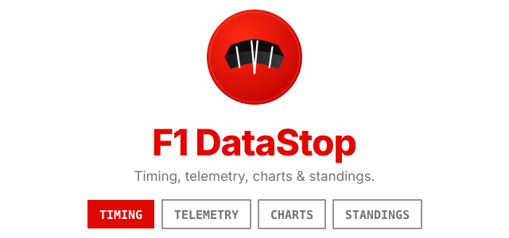

# F1 DataStop

<p align="center">
  
</p>

<p align="center">
  <strong>A free, open-source Formula 1 site: standings, results, lap analysis, telemetry charts and a race calendar.</strong>
</p>

<p align="center">
  <a href="https://github.com/ibrahimroshdy/f1datastop/actions/workflows/pr-ci.yml"></a>
  <a href="https://docs.f1datastop.com"></a>
  <a href="https://github.com/ibrahimroshdy/f1datastop/releases/latest"></a>
  <a href="LICENSE"></a>
</p>

**Live site:** https://www.f1datastop.com · **Documentation:** https://docs.f1datastop.com

Every page works without an account. All data appears after a session ends; there is no live timing.

## Features

- **Dashboard**: standings, last race, countdown to the next race, season overview
- **Analytics**: lap times, position changes, qualifying, pit stops, year comparisons
- **Race calendar**: list, grid and 3D globe views
- **Deep Dive**: telemetry charts and race replays
- **Drivers and constructors**: profiles with team colours
- **Embeddable widgets**: standings tables for your own site

## Quick start

You need Node.js 20 or newer and a free Supabase project.

```bash
git clone https://github.com/ibrahimroshdy/f1datastop.git
cd f1datastop
npm install --prefix web
cp .env.example web/.env.local   # add your Supabase URL and public key
npm run dev                      # http://localhost:8080
```

## Documentation

Everything else is on the docs site:

- [Getting started](https://docs.f1datastop.com/getting-started.html): settings, commands and checks before a pull request
- [How it works](https://docs.f1datastop.com/architecture.html): where the data comes from and project layout
- [Backend](https://docs.f1datastop.com/backend.html): database, migrations and server functions
- [Data and CDN](https://docs.f1datastop.com/data.html): data sources and file storage
- [Scheduled jobs](https://docs.f1datastop.com/pipeline.html): every automatic job and when it runs
- [API and embeds](https://docs.f1datastop.com/api-embeds.html): put standings on your own site
- [Releases](https://docs.f1datastop.com/releases.html): how version numbers are made
- [Runbooks](https://docs.f1datastop.com/runbooks.html): operations and troubleshooting

## Contributing

Contributions are welcome. Read [CONTRIBUTING.md](CONTRIBUTING.md). Pull requests must pass CI (type check, lint, tests, build) and use a conventional title such as `feat(web): add a tyre chart`. Report security problems as described in [SECURITY.md](SECURITY.md).

## License

[MIT](LICENSE).

## Disclaimer

This is an independent, community-run project. It is not affiliated with, endorsed by or sponsored by Formula 1, the FIA, or any team or organiser. Formula 1™, FIA®, Liberty Media and related marks belong to their owners. All data comes from open sources and is used for education and analysis only.

## Acknowledgments

- [Jolpica F1 API](https://github.com/jolpica/jolpica-f1): historical data
- [OpenF1](https://openf1.org/): session data
- [FastF1](https://github.com/theOehrly/Fast-F1): telemetry library
- [shadcn/ui](https://ui.shadcn.com/), [Recharts](https://recharts.org/) and [D3](https://d3js.org/)
